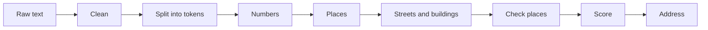

# TrAdres

Clean messy Turkish addresses: split them into parts, check them against official place names and write them in one standard form.

[](https://github.com/AykanYilmz/TrAdres/actions/workflows/ci.yml)

[](https://github.com/AykanYilmz/TrAdres/blob/main/LICENSE)

[Türkçe](https://github.com/AykanYilmz/TrAdres/blob/main/README.tr.md)

> 🚧 Not on PyPI yet. Version 0.1.0 is in preparation.

## Before and after

```text
CANKAYA/ANKARA kizilay mah gmk bulvarı 12/8
```

```json
{
  "il": "Ankara",
  "ilce": "Çankaya",
  "mahalle": "Kızılay",
  "bulvar": "Gazi Mustafa Kemal",
  "bina_no": "12",
  "daire": "8",
  "confidence": 0.97,
  "adres": "Kızılay Mah. Gazi Mustafa Kemal Blv. No:12 D:8 Çankaya/Ankara"
}
```

## Install and use

```bash
pip install git+https://github.com/AykanYilmz/TrAdres.git
```

```python
from tradres import parse

address = parse("ataturk mh 23nisan cd no 5 d 3 bolu merkez")
address.il          # "Bolu"
address.mahalle     # "Atatürk"
address.format()    # "Atatürk Mah. 23 Nisan Cad. No:5 D:3 Merkez/Bolu"
```

TrAdres works offline. The place list comes with the package, and the wheel is about 232 KiB.

## Who is it for?

TrAdres is for **data that already exists**: old customer records, CSV exports and other files with one free-text address column. For a new form, separate input boxes are a better choice.

## Features

- **Finds 14 parts:** il, ilçe, mahalle, bulvar, cadde, sokak, site, bina adı, blok, bina no, kat, daire, posta kodu and tarif (directions such as "okul yanı").
- **Loses nothing:** text it cannot read stays in the `kalan` field.
- **Understands Turkish:** correct `I`/`ı` and `İ`/`i` rules, and `cankaya` gives `Çankaya`.
- **Reads abbreviations:** `Mah.`, `mh`, `Cd.`, `Sk.`, `Blv.`, `No:`, `D:` and more. The list is a data file, so it is easy to add new ones.
- **Accepts any order:** `Merkez/Bolu`, `Bolu Merkez`, and il/ilçe at the start or the end.
- **Fixes typos in place names:** `Kzılay`, `Çankya`. You can change the limits with `MatchConfig`.
- **Checks places:** il, ilçe and mahalle must belong together. A missing il is filled in when the ilçe belongs to only one il.
- **Gives confidence scores:** for the whole address and for each field.
- **Reads Excel files:** finds the encoding and the delimiter of Turkish CSV files.
- **Typed:** full type hints and `mypy --strict`.

## Accuracy

These numbers come from 100 labelled test addresses that the rules were not tuned on. An address counts as exact only if every field is right.

| Field | Precision | Recall | F1 | Addresses |
|---|---:|---:|---:|---:|
| il | 1.000 | 1.000 | 1.000 | 100 |
| ilce | 1.000 | 0.970 | 0.985 | 100 |
| mahalle | 0.970 | 0.970 | 0.970 | 100 |
| bulvar | 1.000 | 1.000 | 1.000 | 8 |
| cadde | 0.939 | 0.939 | 0.939 | 33 |
| sokak | 0.944 | 0.944 | 0.944 | 18 |
| site | 0.857 | 0.857 | 0.857 | 7 |
| bina_adi | 1.000 | 1.000 | 1.000 | 4 |
| blok | 1.000 | 1.000 | 1.000 | 5 |
| bina_no | 1.000 | 1.000 | 1.000 | 57 |
| kat | 1.000 | 1.000 | 1.000 | 7 |
| daire | 1.000 | 1.000 | 1.000 | 19 |
| posta_kodu | 1.000 | 1.000 | 1.000 | 2 |
| tarif | 1.000 | 1.000 | 1.000 | 5 |
| **All fields** | 0.985 | 0.978 | 0.982 | 465 |

**Exact addresses: 91.0% of 100.** A simple baseline gets 36.0% on the same set.

Please read these numbers with care. The same person wrote the rules and the test set, and we looked at the totals many times. Real data can score lower. The test addresses are made up, because we do not use real people's addresses.

### Messy data

This test damages the same 100 addresses in one known way and scores them again.

| Damage | Exact addresses |
|---|---:|
| None | 91% |
| All capitals, or all lower case | 91% |
| No punctuation | 91% |
| Extra spaces | 91% |
| Typo in a place name | 85% |
| No Turkish letters | 85% |
| Lower case, no Turkish letters and no punctuation together | 85% |

Run it yourself with `python -m eval.robustness`.

### Speed

Measured on one Windows laptop with Python 3.12:

| Task | Time |
|---|---:|
| One tidy address | about 230 µs |
| One address with typos | about 700 µs |
| 10,000 addresses | 2.4 s |
| 10,000 CSV rows, with file reading and writing | 2.8 s |
| First load of the place list | 0.2 s |

## How it works



Each step is a small function that says which words it used. Words that no step used go to `kalan`. There is no machine learning: all rules can be read and tested.

### Confidence scores

A score shows how a value was found. **It is a rule, not a probability.**

| Score | Meaning |
|---|---|
| 1.0 | Same as the official name, or a labelled number |
| 0.9 | A keyword marks it, but there is no list to check it against |
| 0.8 | Not written: worked out from another field |
| 0.75 | A typo was corrected |
| 0.6 | The place list does not confirm it, which also happens to real names |
| 0.3 | il, ilçe or mahalle do not belong together |

The address score is the weighted mean of the field scores. il has weight 3, ilçe and mahalle have weight 2, and the others have weight 1. A missing il, ilçe or mahalle counts as 0. Text left in `kalan` lowers the score by up to half.

## Command line

Parse one address:

```bash
tradres parse "Kızılay Mah. Gül Sk. No:5/3 Çankaya/Ankara"
```

Parse a column of a CSV file:

```bash
tradres parse-csv input.csv --column adres -o output.csv
```

Your columns stay as they are. New columns start with `tradres_`: one for each part, then `tradres_kalan`, `tradres_guven` (confidence) and `tradres_adres` (the standard form). The output opens correctly in Excel.

Options: `--encoding`, `--delimiter`, `--output-encoding`, `--no-progress`. See `tradres parse-csv --help`.

## Known limits

- **The place list is not complete.** It has about 46,000 mahalle and köy from Wikidata, but city centres have gaps. A missing mahalle is still read when a keyword marks it, but it gets a lower score, and typos in it may stay.
- **Street names are not checked.** No open list of streets exists, so a typo in a street stays.
- **Scores are not calibrated.** A score of 0.9 does not mean "90% right".

## Roadmap

- FastAPI service and Docker image
- Live demo on Hugging Face Spaces
- Postal code checks
- Several candidates for unclear addresses
- A small model, only if measurements show that rules are not enough

## Contributing

A missing abbreviation or one wrongly parsed address is a great first contribution. See [CONTRIBUTING.md](https://github.com/AykanYilmz/TrAdres/blob/main/CONTRIBUTING.md). Please never share a real person's address.

## Data sources and license

The place names come from [Wikidata](https://www.wikidata.org/) (CC0). See [DATA_SOURCES.md](https://github.com/AykanYilmz/TrAdres/blob/main/DATA_SOURCES.md).

The code uses the [MIT License](https://github.com/AykanYilmz/TrAdres/blob/main/LICENSE).
