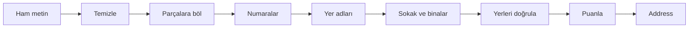

# TrAdres

Dağınık Türkçe adresleri temizler: parçalarına ayırır, resmi yer adlarıyla doğrular ve tek bir standart biçimde yazar.

[](https://github.com/AykanYilmz/TrAdres/actions/workflows/ci.yml)

[](https://github.com/AykanYilmz/TrAdres/blob/main/LICENSE)

[English](https://github.com/AykanYilmz/TrAdres/blob/main/README.md)

> 🚧 Henüz PyPI'da değil. 0.1.0 sürümü hazırlanıyor.

## Önce ve sonra

```text
CANKAYA/ANKARA kizilay mah gmk bulvarı 12/8
```

```json
{
  "il": "Ankara",
  "ilce": "Çankaya",
  "mahalle": "Kızılay",
  "bulvar": "Gazi Mustafa Kemal",
  "bina_no": "12",
  "daire": "8",
  "confidence": 0.97,
  "adres": "Kızılay Mah. Gazi Mustafa Kemal Blv. No:12 D:8 Çankaya/Ankara"
}
```

## Kurulum ve kullanım

```bash
pip install git+https://github.com/AykanYilmz/TrAdres.git
```

```python
from tradres import parse

address = parse("ataturk mh 23nisan cd no 5 d 3 bolu merkez")
address.il          # "Bolu"
address.mahalle     # "Atatürk"
address.format()    # "Atatürk Mah. 23 Nisan Cad. No:5 D:3 Merkez/Bolu"
```

TrAdres internetsiz çalışır. Yer listesi paketle gelir, wheel boyutu yaklaşık 236 KiB'dir.

## Kimin için?

TrAdres **zaten var olan veri** içindir: eski müşteri kayıtları, CSV dışa aktarımları ve serbest metin adres sütunu olan diğer dosyalar. Yeni bir form için ayrı giriş kutuları daha iyi bir seçimdir.

## Özellikler

- **14 parça bulur:** il, ilçe, mahalle, bulvar, cadde, sokak, site, bina adı, blok, bina no, kat, daire, posta kodu ve tarif ("okul yanı" gibi yön tarifleri).
- **Hiçbir şeyi kaybetmez:** okuyamadığı metin `kalan` alanında kalır.
- **Türkçeyi bilir:** doğru `I`/`ı` ve `İ`/`i` kuralları; `cankaya` yazınca `Çankaya` döner.
- **Kısaltmaları okur:** `Mah.`, `mh`, `Cd.`, `Sk.`, `Blv.`, `No:`, `D:` ve daha fazlası. Liste bir veri dosyasıdır, yenisini eklemek kolaydır.
- **Sıra bağımsızdır:** `Merkez/Bolu`, `Bolu Merkez`, il/ilçe başta veya sonda olabilir.
- **Yer adlarındaki yazım hatalarını düzeltir:** `Kzılay`, `Çankya`. Sınırları `MatchConfig` ile değiştirebilirsiniz.
- **Yerleri doğrular:** il, ilçe ve mahalle birbirine uymalıdır. İlçe tek bir ile aitse eksik il doldurulur.
- **Güven skoru verir:** adresin tamamı ve her alan için.
- **Excel dosyalarını okur:** Türkçe CSV dosyalarının kodlamasını ve ayracını bulur.
- **Tiplidir:** tam tip ipuçları ve `mypy --strict`.

## Doğruluk

Bu sayılar, kuralların üzerinde ayarlanmadığı 100 etiketli test adresinden geliyor. Bir adres, ancak bütün alanları doğruysa tam doğru sayılır.

| Alan | Kesinlik | Duyarlılık | F1 | Adres |
|---|---:|---:|---:|---:|
| il | 1.000 | 1.000 | 1.000 | 100 |
| ilce | 1.000 | 0.970 | 0.985 | 100 |
| mahalle | 0.970 | 0.970 | 0.970 | 100 |
| bulvar | 1.000 | 1.000 | 1.000 | 8 |
| cadde | 0.939 | 0.939 | 0.939 | 33 |
| sokak | 0.944 | 0.944 | 0.944 | 18 |
| site | 0.857 | 0.857 | 0.857 | 7 |
| bina_adi | 1.000 | 1.000 | 1.000 | 4 |
| blok | 1.000 | 1.000 | 1.000 | 5 |
| bina_no | 1.000 | 1.000 | 1.000 | 57 |
| kat | 1.000 | 1.000 | 1.000 | 7 |
| daire | 1.000 | 1.000 | 1.000 | 19 |
| posta_kodu | 1.000 | 1.000 | 1.000 | 2 |
| tarif | 1.000 | 1.000 | 1.000 | 5 |
| **Tüm alanlar** | 0.985 | 0.978 | 0.982 | 465 |

**Tam doğru adres: 100 adresin %91,0'i.** Basit bir karşılaştırma yöntemi aynı sette %36,0 alıyor.

Bu sayıları dikkatli okuyun. Kuralları ve test setini aynı kişi yazdı, toplamlara da birçok kez bakıldı. Gerçek veride skor daha düşük olabilir. Test adresleri uydurmadır, çünkü gerçek kişilerin adreslerini kullanmıyoruz.

### Dağınık veri

Bu test, aynı 100 adresi bilinen bir biçimde bozup yeniden puanlar.

| Bozulma | Tam doğru adres |
|---|---:|
| Yok | %91 |
| Tamamı büyük veya tamamı küçük harf | %91 |
| Noktalama yok | %91 |
| Fazla boşluk | %91 |
| Yer adında yazım hatası | %85 |
| Türkçe harf yok | %85 |
| Küçük harf, Türkçe harf yok ve noktalama yok, hepsi birden | %85 |

Kendiniz denemek için: `python -m eval.robustness`.

### Hız

Bir Windows dizüstü bilgisayarda, Python 3.12 ile ölçüldü:

| İş | Süre |
|---|---:|
| Tek düzenli adres | yaklaşık 230 µs |
| Yazım hatalı tek adres | yaklaşık 700 µs |
| 10.000 adres | 2,4 sn |
| 10.000 CSV satırı, dosya okuma ve yazma dahil | 2,8 sn |
| Yer listesinin ilk yüklenmesi | 0,2 sn |

## Nasıl çalışır?



Her adım, hangi kelimeleri kullandığını söyleyen küçük bir fonksiyondur. Hiçbir adımın kullanmadığı kelimeler `kalan` alanına gider. Makine öğrenmesi yoktur: bütün kurallar okunabilir ve test edilebilir.

### Güven skorları

Skor, bir değerin nasıl bulunduğunu gösterir. **Bu bir kuraldır, olasılık değildir.**

| Skor | Anlamı |
|---|---|
| 1.0 | Resmi adla aynı veya etiketli bir numara |
| 0.9 | Bir anahtar kelime işaret ediyor, ama karşılaştırılacak liste yok |
| 0.8 | Yazılmamış: başka bir alandan çıkarıldı |
| 0.75 | Yazım hatası düzeltildi |
| 0.6 | Yer listesi doğrulamıyor; bu gerçek adlarda da olabilir |
| 0.3 | il, ilçe veya mahalle birbirine uymuyor |

Adres skoru, alan skorlarının ağırlıklı ortalamasıdır. il ağırlığı 3, ilçe ve mahalle 2, diğerleri 1'dir. Eksik il, ilçe veya mahalle 0 sayılır. `kalan` alanındaki metin skoru en fazla yarıya kadar düşürür.

## Komut satırı

Tek adres:

```bash
tradres parse "Kızılay Mah. Gül Sk. No:5/3 Çankaya/Ankara"
```

CSV dosyasının bir sütunu:

```bash
tradres parse-csv girdi.csv --column adres -o cikti.csv
```

Kendi sütunlarınız olduğu gibi kalır. Yeni sütunlar `tradres_` ile başlar: her parça için bir sütun, ardından `tradres_kalan`, `tradres_guven` ve `tradres_adres` (standart yazım). Çıktı Excel'de doğru açılır.

Seçenekler: `--encoding`, `--delimiter`, `--output-encoding`, `--no-progress`. Ayrıntı için: `tradres parse-csv --help`.

## Bilinen sınırlar

- **Yer listesi eksiksiz değil.** Wikidata'dan yaklaşık 46.000 mahalle ve köy içeriyor, ama şehir merkezlerinde boşluklar var. Eksik mahalle, anahtar kelimeyle işaretliyse yine okunur; skoru düşük olur ve içindeki yazım hatası düzelmeyebilir.
- **Sokak adları doğrulanmıyor.** Açık bir sokak listesi yok, bu yüzden sokak adındaki yazım hatası kalır.
- **Skorlar kalibre değil.** 0.9 skoru "%90 doğru" demek değildir.

## Yol haritası

- FastAPI servisi ve Docker imajı
- Hugging Face Spaces'te canlı demo
- Posta kodu doğrulaması
- Belirsiz adresler için birden fazla aday
- Küçük bir model, ama sadece ölçümler kuralların yetmediğini gösterirse

## Katkı

Eksik bir kısaltma veya yanlış ayrıştırılan bir adres harika bir ilk katkıdır. [CONTRIBUTING.md](https://github.com/AykanYilmz/TrAdres/blob/main/CONTRIBUTING.md) dosyasına bakın. Lütfen gerçek bir kişinin adresini paylaşmayın.

## Veri kaynakları ve lisans

Yer adları [Wikidata](https://www.wikidata.org/)'dan gelir (CC0). Ayrıntılar: [DATA_SOURCES.md](https://github.com/AykanYilmz/TrAdres/blob/main/DATA_SOURCES.md).

Kod [MIT Lisansı](https://github.com/AykanYilmz/TrAdres/blob/main/LICENSE) ile dağıtılır.
